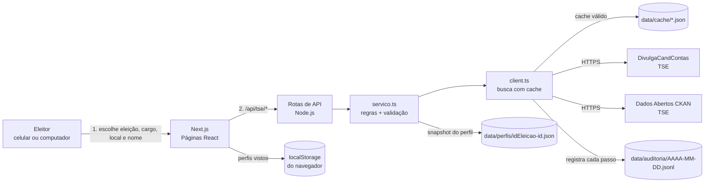
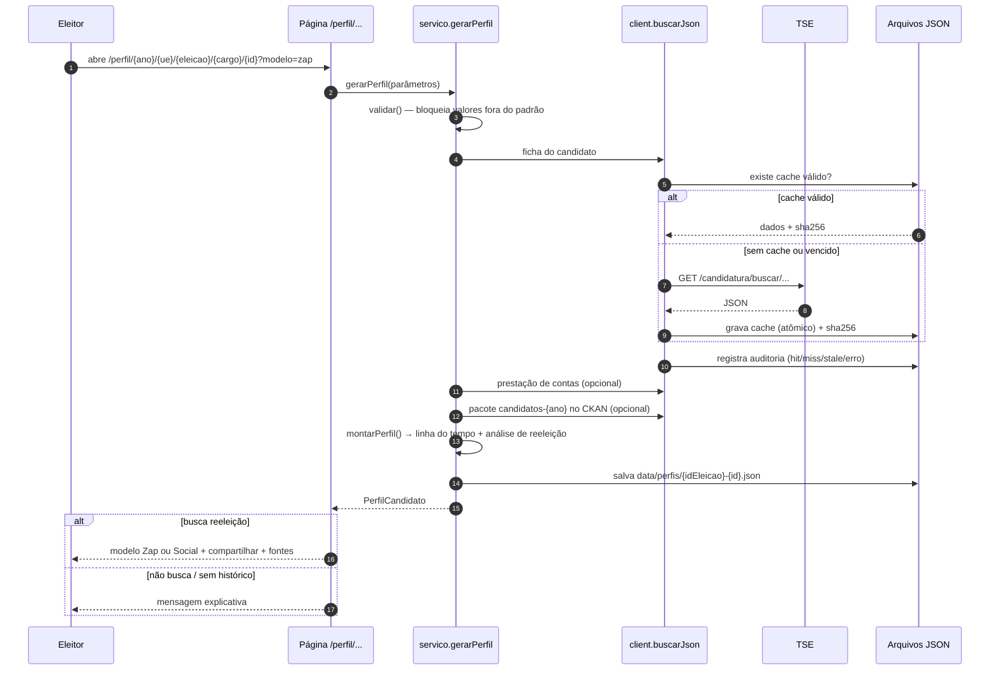

# Eleitor Livre — Arquitetura Auditada

> Documento de arquitetura e trilha de auditoria do processo de consulta, montagem e compartilhamento de perfis de candidatos à reeleição.
> Versão 0.1 · setembro/2026

## 1. Objetivo

Permitir que qualquer eleitor, inclusive com pouca familiaridade com tecnologia, busque um candidato, confirme se ele **busca reeleição** e veja um perfil fácil de entender em dois modelos:

| Modelo | Inspiração | Para quem |
|---|---|---|
| **Zap** | Conversa de WhatsApp (perguntas e respostas em balões) | Quem usa principalmente o celular e grupos de mensagem |
| **Social** | Perfil de Facebook / LinkedIn (capa, sobre, experiência, publicações) | Quem está acostumado a redes sociais |

Requisitos atendidos:

| # | Requisito | Onde está |
|---|---|---|
| R1 | Consultar DivulgaCandContas | `src/lib/tse/endpoints.ts`, `src/lib/tse/servico.ts` |
| R2 | Consultar Portal de Dados Abertos (CKAN) | `endpoints.pacoteDadosAbertos`, bloco "Fontes" do perfil |
| R3 | Perfil só para quem busca reeleição; mensagem se não houver histórico | `src/lib/reeleicao.ts` → `analisarReeleicao`, `AvisoNaoReeleicao.tsx`, `LinhaDoTempo.tsx` |
| R4 | Linha do tempo Anteriores → Atual, com eleito e não eleito | `montarLinhaDoTempo`, `LinhaDoTempo.tsx` |
| R5 | Compartilhar por link do site ou por resumo com dados essenciais | `src/lib/share.ts`, `Compartilhar.tsx`, `generateMetadata` (prévia Open Graph) |
| R6 | Arquitetura auditada | Este documento + `src/lib/audit.ts` + página `/auditoria` |
| R7 | Salvar em JSON / dados locais para acesso rápido | `src/lib/cache.ts` (servidor) + `src/lib/local-store.ts` (navegador) |
| R8 | Tema claro, responsivo, textos leigos e educativos | `globals.css`, componente `Explica`, página `/como-funciona` |

## 2. Visão geral



**Por que as chamadas passam pelo servidor?** As APIs do TSE não liberam CORS para outros sites e às vezes ficam lentas. Passando pelo servidor conseguimos: validar parâmetros, guardar cache, registrar auditoria e continuar funcionando com a última cópia se o TSE cair.

## 3. Fluxo de geração do perfil



## 4. Endpoints consultados

Todas as URLs externas estão em **um único arquivo** (`src/lib/tse/endpoints.ts`), o que facilita auditar exatamente o que o sistema acessa.

| Operação | Método e caminho (base `divulgacandcontas.tse.jus.br/divulga/rest/v1`) | Cache |
|---|---|---|
| Lista de eleições | `GET /eleicao/ordinarias` | 7 dias |
| Municípios da UF | `GET /eleicao/buscar/{UF}/{idEleicao}/municipios` | 30 dias |
| Candidatos do cargo | `GET /candidatura/listar/{ano}/{UE}/{idEleicao}/{cargo}/candidatos` | 12 h |
| Ficha do candidato | `GET /candidatura/buscar/{ano}/{UE}/{idEleicao}/candidato/{id}` | 12 h |
| Prestação de contas | `GET /prestador/consulta/{idEleicao}/{ano}/{UE}/{cargo}/{nrPartido}/{nrCandidato}/{id}` | 6 h |
| Conjunto de dados (CKAN) | `GET dadosabertos.tse.jus.br/api/3/action/package_show?id=candidatos-{ano}` | 7 dias |

**UE (unidade eleitoral):** código do município (eleição municipal), sigla da UF (eleição geral) ou `BR` (presidente).

**Códigos de cargo:** 1 Presidente · 3 Governador · 5 Senador · 6 Dep. Federal · 7 Dep. Estadual · 8 Dep. Distrital · 11 Prefeito · 13 Vereador.

> O TSE não publica contrato formal destas APIs. Todos os tipos em `src/lib/tse/types.ts` são opcionais e a montagem é defensiva. Se um caminho mudar, basta ajustar `endpoints.ts`.

## 5. Regras de negócio (auditáveis e testadas)

Arquivo: `src/lib/reeleicao.ts` · Testes: `scripts/teste-regras.ts` (`npm test`).

### 5.1 Classificação do resultado

| Texto do TSE (exemplos) | Classe | Rótulo exibido |
|---|---|---|
| Eleito, Eleito por QP, Eleito por média | `eleito` | Eleito(a) |
| Não eleito | `nao_eleito` | Não eleito(a) |
| Suplente | `suplente` | Suplente |
| 2º turno | `segundo_turno` | Foi ao 2º turno |
| vazio, `#NULO` | `em_andamento` | Aguardando resultado |

### 5.2 Quem "busca reeleição"

Um candidato é considerado em reeleição se **qualquer** condição for verdadeira:

1. O TSE marca a candidatura com `stReeleicao = true`;
2. Foi **eleito** para o **mesmo cargo** na eleição imediatamente anterior (ano − 4; para senador, ano − 8 ou − 4).

A comparação de cargo ignora acentos, maiúsculas e gênero ("Vereadora" = "VEREADOR(A)"). Eleição anterior para **outro** cargo não conta.

Se não busca reeleição → tela `AvisoNaoReeleicao` com o motivo. Se além disso não há nenhuma eleição anterior → mensagem **"Este candidato não tem histórico eleitoral"**.

### 5.3 Linha do tempo

- **Anteriores:** `eleicoesAnteriores` do TSE, sem duplicatas (ano + cargo), em ordem crescente, com vitórias **e** derrotas.
- **Atual:** a candidatura consultada, marcada como "agora".
- Resumo exibido: disputas, vitórias e derrotas/suplências.

## 6. Trilha de auditoria

Arquivo: `src/lib/audit.ts` · Tela: `/auditoria` · JSON: `GET /api/auditoria?limite=1000`.

Cada consulta gera **uma linha** (append-only, nunca reescrita) em `data/auditoria/AAAA-MM-DD.jsonl`:

```json
{
  "id": "5b1c…",
  "em": "2026-09-28T21:14:00.599Z",
  "origem": "divulgacandcontas",
  "operacao": "Ficha do candidato",
  "url": "https://divulgacandcontas.tse.jus.br/divulga/rest/v1/candidatura/buscar/2024/04278/2045202024/candidato/140001234567",
  "status": 200,
  "ms": 842,
  "cache": "miss",
  "bytes": 18234,
  "sha256": "39f94024cbcf…"
}
```

| Campo `cache` | Significado |
|---|---|
| `miss` | Buscado agora no TSE e gravado no cache |
| `hit` | Servido do cache local ainda válido |
| `stale` | TSE falhou; servida a última cópia (com o erro registrado) |
| `erro` | TSE falhou e não havia cópia |

**Prova de integridade:** o `sha256` é calculado sobre o corpo **bruto** recebido do TSE. O mesmo hash aparece no bloco "Transparência" do perfil. Para verificar:

```bash
curl -s "<url do registro>" | sha256sum   # deve bater com o hash, se o TSE não mudou o dado
```

## 7. Armazenamento local (acesso rápido)

| Onde | O quê | Formato | Validade |
|---|---|---|---|
| `data/cache/<sha1(url)>.json` | Resposta bruta do TSE + `salvoEm`, `expiraEm`, `sha256`, `bytes` | JSON | TTL por tipo (seção 4) |
| `data/perfis/<idEleicao>-<id>.json` | Perfil já montado (snapshot) | JSON | Reaproveitado se o TSE estiver fora |
| `data/auditoria/*.jsonl` | Trilha de auditoria | JSON Lines | Permanente |
| `localStorage["eleitorlivre:recentes:v1"]` | Até 8 perfis vistos neste aparelho | JSON | Até o usuário limpar |
| `data/demo/candidato-exemplo.json` | Candidato **fictício** para demonstração (`/exemplo`) | JSON | Fixo |

Gravação **atômica** (arquivo temporário + `rename`) evita JSON corrompido. Em ambiente somente-leitura o sistema segue sem cache em disco (auditoria cai para memória). Na Vercel a pasta padrão é `/tmp/eleitorlivre`; para persistência real em produção, aponte `ELEITOR_DATA_DIR` para um volume ou troque `cache.ts` por um armazenamento (ex.: Redis/KV) mantendo a mesma interface.

## 8. Segurança e privacidade

| Controle | Implementação |
|---|---|
| Injeção de caminho nas URLs do TSE | `validar()` com expressões regulares estritas (ano, UE, UF, id, cargo) antes de montar qualquer URL |
| Timeout | 15 s (ficha) / 10 s (dados complementares) via `AbortSignal.timeout` |
| Links externos | `rel="noopener noreferrer"`; sites de candidatos com `nofollow` |
| Fotos | `referrerPolicy="no-referrer"` |
| Cabeçalhos | `X-Content-Type-Options: nosniff`, `Referrer-Policy` |
| Dados pessoais | Apenas dados **públicos** divulgados pelo TSE. O perfil montado não inclui CPF, título ou e-mail; o cache bruto (`data/cache`) guarda a resposta exatamente como o TSE publicou, para fins de auditoria, e fica fora do Git |
| Honestidade do modelo Zap | Aviso fixo: "Mensagens automáticas montadas com dados oficiais do TSE. Não é o candidato escrevendo." |
| Exemplo fictício | Rotulado na tela e no resumo compartilhado |

## 9. Compartilhamento

- **Link do site:** `/perfil/{ano}/{ue}/{idEleicao}/{cargo}/{id}?modelo=zap|social` — endereço estável, com prévia (Open Graph: nome, número, partido, foto).
- **Resumo essencial:** texto pronto (nome, número, partido, cargo, se busca reeleição, anos em que foi eleito, resultado atual, bens e link).
- Canais: botão nativo do celular (Web Share API), WhatsApp, Facebook, LinkedIn, copiar link, copiar resumo.

## 10. Estrutura de pastas

```
src/
  app/
    page.tsx                         Busca (passo a passo)
    perfil/[ano]/[ue]/[eleicao]/[cargo]/[id]/page.tsx   Perfil
    exemplo/page.tsx                 Perfil fictício de demonstração
    auditoria/page.tsx               Trilha de auditoria (leiga)
    como-funciona/page.tsx           Explicação + glossário
    api/tse/{eleicoes,municipios,candidatos,perfil}/route.ts
    api/auditoria/route.ts
  components/
    busca/BuscaCandidato.tsx         Wizard de busca
    perfil/TemplateZap.tsx           Modelo WhatsApp
    perfil/TemplateSocial.tsx        Modelo Facebook/LinkedIn
    perfil/LinhaDoTempo.tsx          Anteriores → Atual
    perfil/Compartilhar.tsx          Link + resumo
    perfil/Fontes.tsx                Transparência (hash, data, links)
    perfil/AvisoNaoReeleicao.tsx     Mensagem de sem reeleição / sem histórico
    ui/*                             Componentes base (padrão shadcn/ui)
  lib/
    tse/endpoints.ts                 Catálogo único de URLs + TTL
    tse/client.ts                    fetch + cache + auditoria
    tse/servico.ts                   Casos de uso
    tse/types.ts, tse/cargos.ts
    reeleicao.ts, montar-perfil.ts   Regras puras (testadas)
    cache.ts, audit.ts               Persistência JSON
    local-store.ts                   localStorage (navegador)
    share.ts, format.ts, validar.ts
data/                                Cache, auditoria, perfis (gerados) e demo
scripts/teste-regras.ts              Testes das regras
```

## 11. Checklist de auditoria

- [x] Toda URL externa definida em um só arquivo
- [x] Parâmetros validados antes de chegar ao TSE
- [x] Cada consulta registrada com data, URL, status, tempo, situação de cache e SHA-256
- [x] Registro append-only; linhas corrompidas são ignoradas, nunca apagadas
- [x] Hash exibido ao eleitor junto do link para a fonte oficial
- [x] Regras de reeleição e linha do tempo isoladas em funções puras com testes
- [x] Falha do TSE não derruba o site (cópia local sinalizada na tela)
- [x] Dado fictício sempre rotulado

## 12. Limitações conhecidas

- As APIs do DivulgaCandContas não são documentadas oficialmente; caminhos e campos podem mudar entre eleições.
- O TSE pode bloquear acessos de fora do Brasil ou em alto volume; hospede em região brasileira quando possível.
- `eleicoesAnteriores` só traz as eleições que o TSE conseguiu vincular ao mesmo CPF.
- O Portal de Dados Abertos entrega arquivos grandes (ZIP/CSV); o app apenas aponta para eles, sem processá-los.
